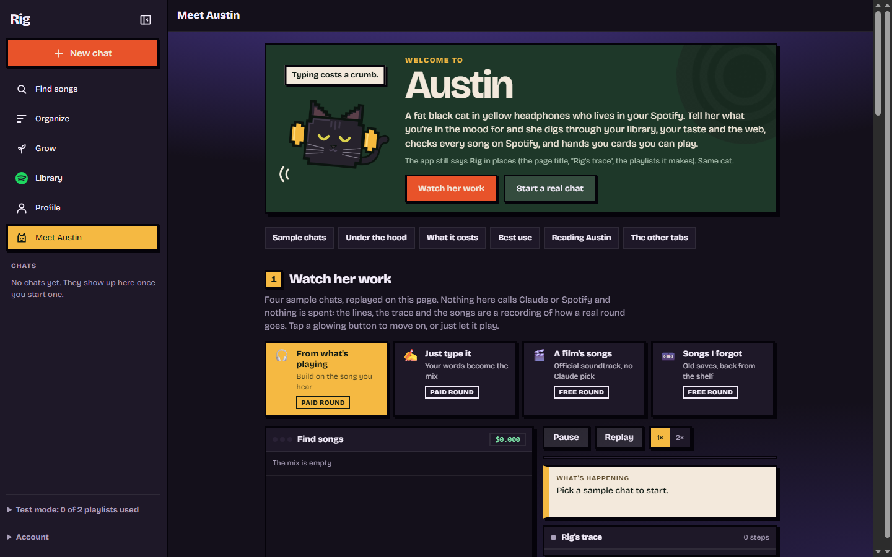
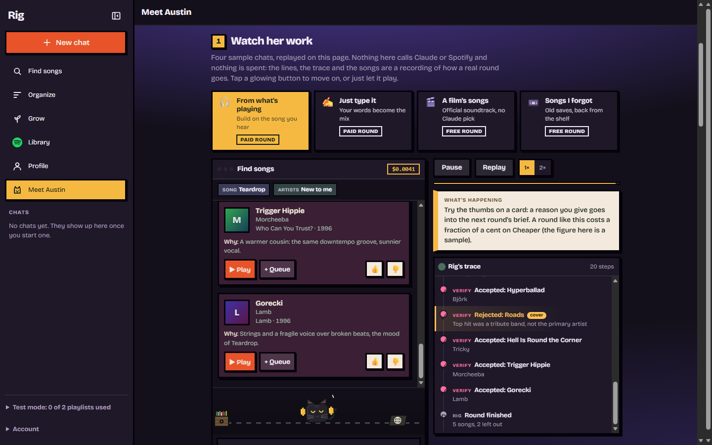
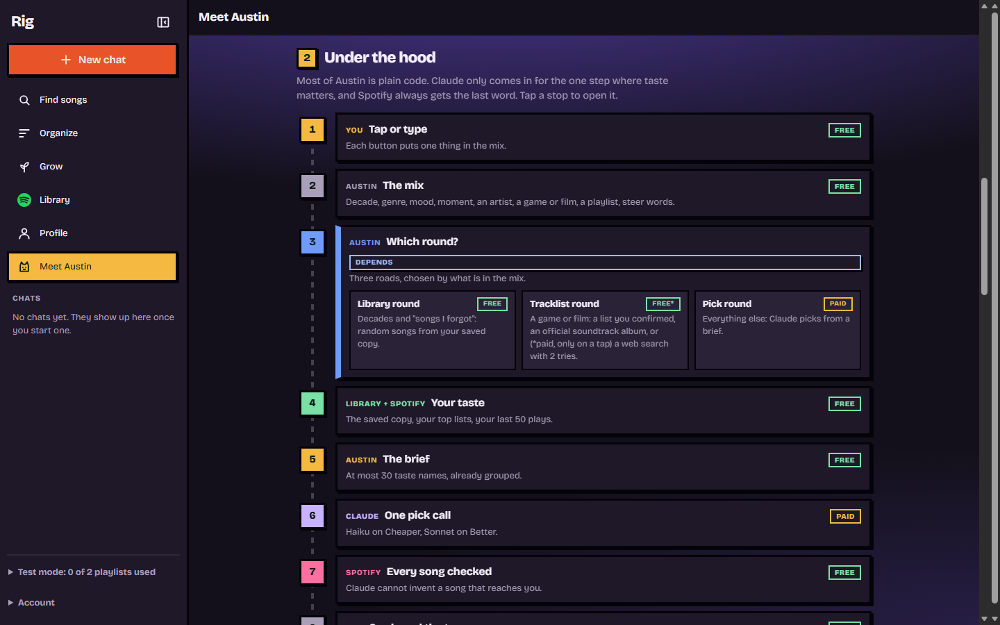

# Rig: Austin, an AI music friend for Spotify

A personal web service that finds music with me, in a chat, inside my own Spotify.
Its guide is **Austin**: my cat, redrawn in code as a fat black cat in yellow headphones who walks between a record crate and a computer while it works.

> **The source is private** because the app runs against my own Spotify account and API keys.
> This page shows what it does and how it's built. I'm happy to walk through the code in an interview.

## What it does

- **Find songs:** a chat that builds a "mix" from taps or typed words: a decade, genre, mood, moment, artist, a game or film soundtrack, one of my playlists, or steer words.
  Austin returns song cards I can play, queue, or rate with a thumbs up or down, and each card says why it was picked.
- **Organize and Grow:** group a playlist's songs, or suggest verified songs to add to one.
- **Library:** a daily copy of my playlists and Liked Songs, with a day-by-day history of what was added, removed or renamed.
- **Profile:** stats from that library, plus an optional paid "read" in which every trait has to cite a fact from the stats.
- **Now playing:** a balloon over Austin's head with the cover, skip and pause, and a save button for a capture playlist.

## How it's built

**Python · FastAPI · httpx · SQLite · vanilla JS · Railway (Docker) · Claude API · Spotify Web API**

Most of Austin is plain code. Claude is used only in the one step where taste matters, and Spotify always gets the last word.

- **Three kinds of round, picked by code:**
  - *Library:* forgotten songs from the saved library. Free, with no AI.
  - *Tracklist:* songs from a game or film soundtrack, taken from a list I confirmed, an official album on Spotify, or (only on a tap) a paid web search.
  - *Pick:* one Claude call with a JSON schema, for everything else.
- **Claude can't invent a song.** Every pick is searched on Spotify and must match the artist and title exactly, so covers, karaoke and tribute bands are rejected. Among the matching versions, the original album wins over a compilation.
- **Cost controls everywhere:**
  - real token usage and web searches are billed to a spending cap, failed rounds included;
  - a paid read checks its worst-case cost before the call is made;
  - the brief sent to the model is capped at 30 grouped taste names;
  - a cheap model handles typed words, and its answer is validated before it's used.
- **A visible step trace:** every backend decision (search, filter, retry, rejection, cost) appears as a step in a collapsible "trace" panel. The rule is that a backend change without a trace step isn't finished.
- **Safety with a real account:**
  - a test mode caps the playlists the app may create, and each one is recorded in a ledger before it's written;
  - writes to my own playlists are logged first and can be undone;
  - a damaged record stops all writes instead of resetting the limits.
- **A daily library sync** runs inside the app and is the only code that reads my playlists. It diffs each read against the last one, in the same transaction, to log changes. It treats an incomplete read as "keep the old copy", never as "songs were removed".
- **Spotify's API limits** (Development Mode drops fields such as popularity and genres, and some endpoints hit long rate limits) are handled as "profile unavailable" rather than as errors.
- **Login and security:** a single password protects the app (signed cookie, fail-closed), Spotify login uses PKCE, and keys stay in environment variables, never in the repo.

## Testing

- **1,490 pytest tests,** with no network: Claude and Spotify are stubbed.
- **A headless-Edge page check** drives the whole chat UI under a stubbed `fetch` and asserts on the page (300+ checks). It also takes the screenshots on this page.

## Timeline

Built in November 2026, in about a week, from a PowerShell prototype: a Windows per-app volume mixer with a Spotify remote and a "Friend" tab.
The Friend tab was then ported to Python and FastAPI as a deployed service.

---

Made by [João Pedro Longo Zucoloto](https://www.linkedin.com/in/jo%C3%A3o-pedro-longo-zucoloto-169638182/) · joaozuco@gmail.com
